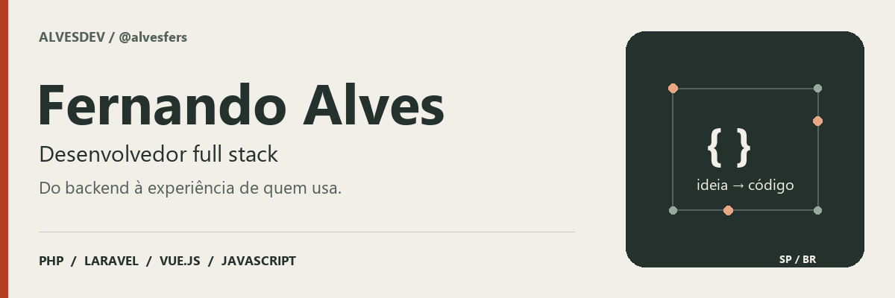

  

  <a href="https://alvesdev.com.br/">Portfólio</a> ·
  <a href="https://www.linkedin.com/in/fernando-morais-alves/">LinkedIn</a> ·
  <a href="mailto:lfma020101@gmail.com">E-mail</a>

Prefere sem animação? <a href="assets/profile-banner.png">Veja o banner estático.</a>

## Olá, sou o Fernando 👋

Sou desenvolvedor **full stack**, de **São Paulo**. Desenvolvo sistemas web, APIs e integrações, do banco de dados à interface. Trabalho também com manutenção em produção, modernização de aplicações e automações.

**Stack principal:** PHP · Laravel · Vue.js · JavaScript · MySQL

**No dia a dia:** Tailwind CSS · Vite · Git · APIs REST

## Projetos em destaque

### Nobilex

Plataforma de gestão administrativa para escritórios de advocacia. Atuo no desenvolvimento do backend com **Laravel** e das interfaces com **Vue.js**, conectando as rotinas do escritório em um sistema web.

### TLC

Sistema para organização e gestão de retiros de um movimento católico. Desenvolvo funcionalidades para apoiar a operação dos eventos e a organização das informações.

### [AlvesDev](https://alvesdev.com.br/)

Meu portfólio de desenvolvimento web. Reúne sites, landing pages e sistemas que desenvolvo, com exemplos de interfaces responsivas e experiências web.

**[Explore os projetos no portfólio →](https://alvesdev.com.br/portfolio)**

## Vamos conversar

Sobre desenvolvimento web, integrações ou um projeto: **[LinkedIn](https://www.linkedin.com/in/fernando-morais-alves/)** · **[E-mail](mailto:lfma020101@gmail.com)**
